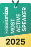
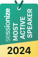
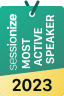

<!-- _class: lead cover -->
<!-- _paginate: false -->

<span class="eyebrow">Aspire 17</span>

<h1 class="cover-title">Qué es, para qué sirve y qué trae de nuevo</h1>

<p class="subtitle">De una carpeta vacía a dos APIs, PostgreSQL, Redis y Docker Compose.</p>

**Emiliano Montesdeoca del Puerto**

<p class="event-name">.NET Conf 2026 · .NET Baires · Online</p>

<!--
TIEMPO: 0:00–0:30

Abrir con una promesa concreta: no voy a empezar con una lista de herramientas. Vamos a construir
una aplicación distribuida pequeña y, después, revisaremos qué aporta Aspire 17 sobre esa base.
-->

---

<!-- _class: bio -->

## Hola, soy Emi

<div class="bio-layout">
  <div class="bio-copy">
    <ul>
      <li>Nací en Uruguay, de corazón canario</li>
      <li>Cloud Solutions Team Lead · Intelequia</li>
      <li>Microsoft MVP en Developer Technologies desde 2022</li>
      <li>Organizador, bloguero y speaker</li>
    </ul>
    <div class="bio-badges">
      
      
      
      
    </div>
  </div>
  
</div>

<!--
TIEMPO: 0:30–1:00

Presentación breve. Lo importante para esta charla: trabajo con equipos que necesitan poder clonar,
entender y ejecutar una aplicación distribuida sin depender de instrucciones orales ni del README
mental de una sola persona.
-->

---

<!-- _class: centered -->

<span class="eyebrow">La pregunta</span>

# ¿Qué forma una aplicación?

<!--
TIEMPO: 2:00–2:20

Dejar dos segundos. Preguntar al chat o al público y aceptar dos respuestas. Todavía no dar la
respuesta completa.
-->

---

## Una app es mucho más que el código

<div class="grid-4">
  <div class="component-card">Servicios</div>
  <div class="component-card">Base de datos</div>
  <div class="component-card">Caché</div>
  <div class="component-card">Secretos</div>
  <div class="component-card">Endpoints</div>
  <div class="component-card">Dependencias</div>
  <div class="component-card">Salud</div>
  <div class="component-card">Logs</div>
  <div class="component-card">Traces</div>
  <div class="component-card">Métricas</div>
  <div class="component-card">Despliegue</div>
  <div class="component-card">Onboarding</div>
</div>

<blockquote>Cada pieza puede tener sentido. El dolor aparece cuando hay que conectarlas, arrancarlas y explicarlas de la misma forma.</blockquote>

<!--
TIEMPO: 2:20–3:10

Recorrer rápido las cajas. Pedir que se imaginen un repo nuevo: ¿cuántos pasos se necesitan antes de
ver la primera petición atravesando dos servicios?
-->

---

## El problema no es escribir la API

<div class="cols">
<div>

### Sin un modelo común

- URLs distintas en cada equipo
- contenedores arrancados a mano
- secretos y puertos copiados
- esperas de inicio no declaradas
- observabilidad configurada al final
- despliegue descrito en otro sitio

</div>
<div>

### Con Aspire

- recursos declarados en código
- referencias y orden de arranque explícitos
- configuración inyectada
- dashboard unificado
- misma topología para publicar

</div>
</div>

<!--
TIEMPO: 3:10–4:10

Aclarar: Aspire no hace desaparecer la complejidad de la arquitectura. Evita que esa complejidad
viva repartida en scripts, variables, documentos y memoria tribal.
-->

---

## ¿Qué es Aspire?

**Aspire es una forma code-first de describir aplicaciones distribuidas y las herramientas para desarrollarlas localmente y publicarlas.**

<div class="grid-3">
  <div class="feature-card">
    <h3>Modelo</h3>
    <p>Proyectos, contenedores, bases de datos, mensajes, nubes y dependencias.</p>
  </div>
  <div class="feature-card">
    <h3>Experiencia local</h3>
    <p>Arranque, endpoints, health checks, discovery, logs, traces y métricas.</p>
  </div>
  <div class="feature-card">
    <h3>Publicación</h3>
    <p>Docker Compose, Kubernetes, Azure y otros targets desde el mismo AppHost.</p>
  </div>
</div>

<blockquote>No reemplaza ASP.NET Core, PostgreSQL, Redis ni Kubernetes. Conecta su ciclo de desarrollo.</blockquote>

<!--
TIEMPO: 4:10–5:30

Definición intencional. Aunque empezó muy ligado a .NET, hoy el modelo también sirve para Node,
Python, Go, JavaScript y TypeScript. Esta demo usa .NET 10.
-->

---

## El modelo mental

<div class="cols">
<div>

```csharp
var builder = DistributedApplication
    .CreateBuilder(args);

var database = builder
    .AddPostgres("postgres")
    .AddDatabase("aspiredemo");

builder.AddDotnetProject(
        "sub-api",
        "../SubApi/SubApi.csproj")
    .WithReference(database)
    .WaitFor(database);

builder.Build().Run();
```

</div>
<div>

| Concepto | Significado |
|---|---|
| **AppHost** | Programa ejecutable que define la aplicación |
| **Recurso** | Proyecto, contenedor, base o entorno |
| **Referencia** | Descubrimiento + configuración |
| **WaitFor** | Dependencia de arranque |
| **Dashboard** | Vista operativa local |
| **Publisher** | Artefactos o despliegue |

</div>
</div>

<!--
TIEMPO: 5:30–7:00

Leer el AppHost de arriba abajo. No es YAML declarativo en otro proceso: es código, así que puede
tener condiciones, variables, helpers, repositorios compartidos y tipos. `WithReference` no es solo
una flecha visual; inyecta la configuración de conexión.
-->

---

<!-- _class: lead centered -->
<!-- _paginate: false -->

# IT'S DEMO TIME

<!--
TIEMPO: 7:00–18:00

Dejar esta slide mientras se hace toda la demo. El guion completo está en `demo/GUIA.md`.

DEMO 1 · Dos APIs · 7:00–10:00
- Crear AspireDemoLive con el AppHost, Api y SubApi.
- Copiar AppHost.cs y ambos Program.cs de la guía.
- Ejecutar `dotnet build AspireDemo.sln` y `aspire run`.
- Llamar a 8081 y 8080.
- Mostrar recursos, grafo `api → sub-api` y la traza.
- Subrayar `https+http://sub-api`: el nombre del recurso se convierte en service discovery.

DEMO 2 · PostgreSQL · 10:00–13:30
- Detener Aspire.
- Instalar Aspire.Hosting.PostgreSQL 17.0.0 y Aspire.Npgsql 17.0.0.
- Añadir el servidor, la base `aspiredemo`, WithReference y WaitFor.
- Registrar AddNpgsqlDataSource y consultar current_database(), server_version y clock_timestamp().
- Volver a ejecutar y mostrar la traza `api → sub-api → PostgreSQL`.
- Api no cambia: solo conoce a SubApi.

DEMO 3 · Redis · 13:30–17:00
- Detener Aspire.
- Instalar Aspire.Hosting.Redis 17.0.0 y Aspire.StackExchange.Redis 17.0.0.
- Añadir `cache`, referenciarlo desde `api` y registrar AddRedisClient.
- Ejecutar dos veces `curl http://localhost:8080/database-info`.
- Ambas respuestas tienen el mismo texto. En la primera traza aparece PostgreSQL; en la segunda,
  Redis, y ya no se atraviesa SubApi.

CIERRE · 17:00–18:00
- Mostrar la aplicación completa en Recursos/Graph.
- Señalar ServiceDefaults: salud, discovery y OpenTelemetry sin instrumentación manual.
- Detener Aspire.
- Transición: esta es la base de Aspire; ahora veamos qué cambió en la versión 17.

PLAN B
- Si un pull o un build tarda, abrir directamente la solución final de `src/`.
- Si falla una petición, mostrar la traza grabada o la solución final y continuar narrando el paso.
-->

---

<!-- _class: lead centered -->
<!-- _paginate: false -->

<span class="eyebrow">Lanzada el 17 de noviembre de 2026</span>

# Aspire 17: qué cambió

<!--
TIEMPO: 18:00–18:20

Cambiar explícitamente de demo a versión. Todo lo anterior representaba la propuesta de valor base;
lo siguiente son novedades del release.
-->

---

## Dashboard rediseñado alrededor de recursos

<div class="grid-3">
  <div class="feature-card">
    <h3>Home en tabla</h3>
    <p>Todos los recursos, estado, tipo, endpoints, tráfico y latencia.</p>
  </div>
  <div class="feature-card">
    <h3>Panel compartido</h3>
    <p>Buscar, filtrar, seleccionar varios y conservar contexto entre vistas.</p>
  </div>
  <div class="feature-card">
    <h3>Todo en un recurso</h3>
    <p>Salud, endpoints, consola, logs, trazas y métricas.</p>
  </div>
  <div class="feature-card">
    <h3>All resources</h3>
    <p>Error rate, p95, endpoints lentos, actividad y recursos ocupados.</p>
  </div>
  <div class="feature-card">
    <h3>Terminals</h3>
    <p>Página dedicada para terminales interactivas y sus réplicas.</p>
  </div>
  <div class="feature-card">
    <h3>Mermaid</h3>
    <p>Exportar el grafo desde el Dashboard o con la CLI.</p>
  </div>
</div>

<!--
TIEMPO: 18:20–19:45

Subrayar el cambio de centro: antes navegábamos por tipos de telemetría; ahora empezamos por un
recurso y llevamos su contexto a logs, traces y métricas. El comando de exportación es
`aspire describe --format mermaid`.
-->

---

## CLI 17: más útil para equipos

<div class="cols">
<div>

### Día a día

```bash
aspire update --self
aspire update

aspire completions script bash

aspire tray start
aspire ps
```

</div>
<div>

### Equipo y entornos

- secretos separados con `--environment`
- fuentes reutilizables de templates
- integraciones internas del equipo
- configuración de skills para agentes
- `aspire agent init` por cliente y alcance

</div>
</div>

<!--
TIEMPO: 19:45–21:00

La novedad no es solo "más comandos". Las sources permiten llevar scaffolding e integraciones
privadas al flujo estándar. El tray companion está en preview y requiere instalación nativa de CLI.
-->

---

## Go AppHost + extensiones de editor

<div class="cols">
<div>

### Go AppHosts · preview

- templates sin feature flag
- `aspire init --language go`
- starter con Go, React y Redis
- debugging con Delve
- `aspire doctor` valida Go
- SDK exportado para referencia

</div>
<div>

### VS Code + agentes

- attach al recurso ya iniciado
- funciona con .NET y Go
- herramientas para estado, fallos y Hot Reload
- abrir Dashboard sin exponer URLs o logs sensibles
- resultados acotados para coding agents

</div>
</div>

<!--
TIEMPO: 21:00–22:30

No presentar Go AppHost como GA: está en preview. La parte estable que sí importa es que Aspire deja
de ser solamente una experiencia centrada en C# y amplía las herramientas, incluida la inspección
segura desde agentes de IA.
-->

---

## Kubernetes ya es estable

<div class="cols">
<div>

### Paquetes graduados

- `Aspire.Hosting.Kubernetes`
- `Aspire.Hosting.Azure.Kubernetes`
- requiere Helm 4 para Helm-based deploy
- puede publicar a un cluster AKS existente

</div>
<div>

### Y en AKS

- tier Standard por defecto
- OS SKU configurable
- identidades separadas
- cert-manager con External Account Binding

</div>
</div>

<div class="result">
El AppHost sigue siendo el modelo. Docker Compose o Kubernetes son targets de publicación.
</div>

<!--
TIEMPO: 22:30–23:40

La estabilización cubre los paquetes y el flujo principal. Algunas APIs específicas, como volúmenes
persistentes, siguen experimentales. Mentionar el coste/SLA adicional de AKS Standard.
-->

---

## Más novedades de 17

<div class="grid-3">
  <div class="feature-card">
    <h3>Microsoft Entra ID</h3>
    <p>Modela registros y service principals desde el AppHost · preview.</p>
  </div>
  <div class="feature-card">
    <h3>API Management</h3>
    <p>Gateways, backends y políticas · recurso solo de despliegue.</p>
  </div>
  <div class="feature-card">
    <h3>Azure AI</h3>
    <p>Nuevos clientes sobre OpenAI SDK y Foundry projects.</p>
  </div>
  <div class="feature-card">
    <h3>Parámetros opcionales</h3>
    <p>Pueden faltar sin romper run o publish.</p>
  </div>
  <div class="feature-card">
    <h3>Browser origins</h3>
    <p>Orígenes reales para CORS y redirects, incluso detrás de proxies.</p>
  </div>
  <div class="feature-card">
    <h3>APIs graduadas</h3>
    <p>Menos diagnósticos experimentales que hay que suprimir.</p>
  </div>
</div>

<!--
TIEMPO: 23:40–24:30

Elegir dos o tres según el público. También cambiaron imágenes por defecto: PostgreSQL 18.6 y Redis
8.10. La demo usa esas defaults al no fijar una imagen manualmente.
-->

---

## Cómo migrar a 17 sin sorpresas

1. **Actualiza el CLI:** `aspire update --self`
2. **Actualiza paquetes:** `aspire update`
3. **AppHost en .NET 10+**; tus workloads pueden seguir en otros frameworks
4. **Reemplaza `AddProject<T>` por `AddDotnetProject`**
5. **Migra `Aspire.AppHost.Sdk`**: ahora es obsoleto
6. Revisa breaking changes y elimina supresiones de APIs ya estables

```bash
dotnet build
aspire doctor
aspire run
```

<p class="takeaway">La mejor demo de Aspire sigue siendo: clonar el repo y arrancar con un comando.</p>

<!--
TIEMPO: 24:30–25:00

No dejar esta slide como checklist exhaustivo. Es una invitación a consultar las notas de release,
porque también hay breaking changes de paquetes retirados, AKS y cambios de OpenTelemetry.
-->

---

<!-- _class: lead -->
<!-- _paginate: false -->

# Gracias

## ¿Preguntas?

**Emiliano Montesdeoca**
linkedin.com/in/emimontesdeoca · @emimontesdeocaa

**Repo:** github.com/emimontesdeoca/aspire-17-netconf-baires-2026

<!--
TIEMPO: 25:00–30:00

Dejar puesta la slide durante preguntas.

Preguntas previsibles:
- ¿Es solo para .NET? Aspire está escrito para aplicaciones distribuidas y hoy soporta varios
  lenguajes; el AppHost puede ser C#, TypeScript o Go.
- ¿Sustituye Kubernetes? No. Kubernetes, Docker Compose o Azure son destinos de publicación.
- ¿Necesito Docker para todo? Para contenedores como PostgreSQL y Redis, sí; o un runtime compatible.
- ¿Puedo usar servicios ya existentes? Sí, con referencias y connection strings existentes.
- ¿La demo funciona sin internet? Una vez restaurados los paquetes y precargadas las imágenes.
- ¿Go AppHost es estable? No, está en preview en Aspire 17.
- ¿Kubernetes es estable? Sí, los paquetes principales; algunas APIs concretas siguen experimentales.

Fuente principal:
https://aspire.dev/whats-new/aspire-17/
-->
